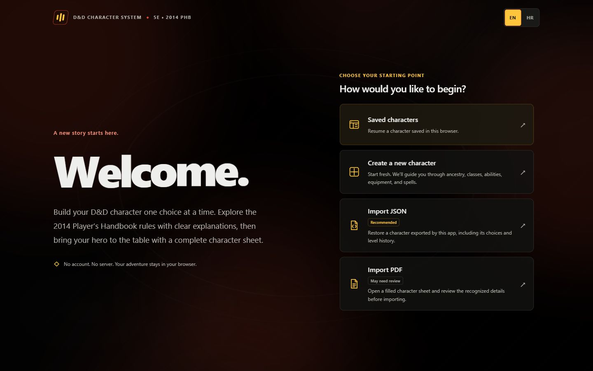
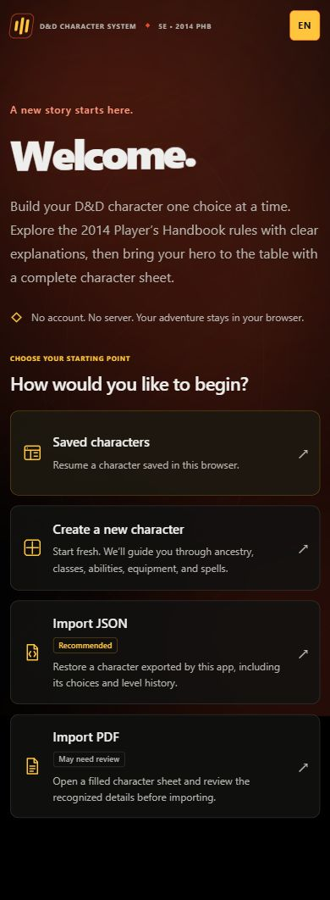

# D&D 5E Character Creator — 2014 PHB

A browser-only React and TypeScript character builder with nine guided stages, English/Croatian explanations, local drafts, JSON recovery, and the standard fillable character-sheet PDF. The visual design uses OLED black, warm gray surfaces, red-orange actions, amber selections, and white selected hover states. Exotic-language badges use a purple-to-cyan gradient. See [DESIGN.md](DESIGN.md) for the palette and sources.

## Screenshots

### Desktop

The welcome message and starting options sit side by side.



### Mobile

The welcome message sits above the options, with the whole page scrollable.



## Run

Install Node.js and pnpm, then open a terminal in this folder:

```sh
pnpm install
pnpm dev
```

Open the local address printed in the terminal. A second running copy may use a different port. Production commands:

```sh
pnpm build
pnpm preview
```

Run regression checks with `pnpm test`.

## Source organization

Source is grouped into catalogs, the character engine, translations, storage, PDF handling, and UI. Race/class summaries and detailed rules have been consolidated by domain; translation patch files have been folded into their owners. Each creation stage has a consistent component file. See [ARCHITECTURE.md](ARCHITECTURE.md) for the file map and ownership rules.

## Character creation

The nine stages cover origin, identity, background, abilities, proficiencies, class choices, gear/spells, review, and the final sheet. Confirm each stage to advance. Visited stages remain editable. Ability allocation includes the same advancement editor used by class choices, so earlier ASIs can qualify later multiclass entries. Later increases cannot qualify an earlier entry.

Race traits, level-specific class and subclass features, feats, proficiencies, spells, and attacks are generated from structured choices. The shared sheet calculation includes formulas and contributing sources. Owned items and equipped armor, shields, and weapon modes are separate. Unknown decisions are reported rather than supplied automatically.

The catalog includes all nine race families, twelve class level trees, forty PHB subclasses, thirteen base backgrounds with variants, forty-two feats, spell definitions, tools, languages, packs, and equipment. These counts describe implemented records; they are not a claim that every entry is independently verified against the complete book. See [SOURCE_AUDIT.md](SOURCE_AUDIT.md) for coverage and source-access dependencies. The app's Review stage exposes the same audit.

## Saving and recovery

Drafts autosave in this browser. JSON export preserves the full build. Imports and resets keep a recovery copy; corrupt or incompatible saved data is preserved verbatim before replacement. If that backup fails, automatic saving pauses and the original can be downloaded. Browser storage can be cleared or unavailable, so export important builds as files.

Language preference is stored separately from character mechanics. Switching language never translates player-authored story text. PDF language can be selected independently.

## PDF workflow

The standard blank 2014 fillable PDF is bundled with the app and loads automatically. **Export filled PDF** maps the current character into that form without requiring an upload. **Use custom template** optionally stores another supported template in this browser. **Import PDF** loads a character and reviews conflicting mechanical edits; it does not replace the export template. The bundled template remains available even when browser template storage is unavailable.

Export maps identity and individual appearance fields, ability scores, six saves, eighteen skills, proficiency indicators, combat values, attacks, currency, equipment, features, narrative, and spell pages from the shared sheet model. Long content continues onto numbered readable pages. Incomplete builds include a DRAFT/NACRT notice and an audit continuation. The original form remains fillable.

App-generated PDFs embed the versioned character and a baseline of visible fields. Re-import restores the level path, subclasses, feats, branches, equipment, and spell choices. Unchanged attacks remain automatic. Direct story edits are preserved; differing mechanical values are offered as explicit overrides, which can later be cleared in Review.

External PDFs cannot encode missing acquisition history or every character choice. Their raw fields are retained, uncertain interpretations are flagged, and imported final scores are preserved without applying ancestry bonuses twice. The supplied English/Croatian example sheets are regression fixtures. No backend, account, telemetry, or remote character storage is used.
